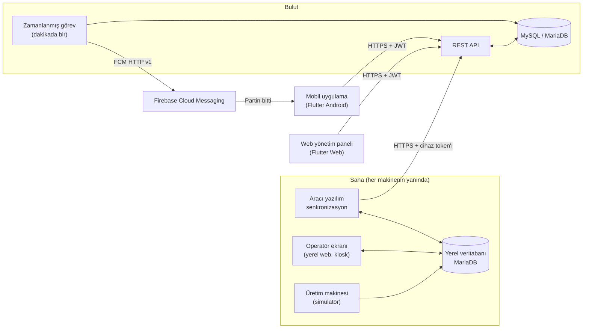

# qbots · Üretim Bilgisi Kontrol Sistemi

> Üretim hatlarında kalite kontrol sonuçlarını sahadan buluta taşıyan, yöneticiye web paneliyle,
> operatöre mobil bildirimle ulaştıran uçtan uca bir sistem.
> Zorunlu stajımı yaptığım yazılım şirketi için staj süresince (2026) geliştirdim.

*English summary below · [English](#english-summary)*

> Bu depo projenin **tanıtım** sayfasıdır. Kaynak kodu staj yaptığım şirkete ait olduğu için paylaşılmamıştır;
> burada mimari, özellikler, kullanılan teknolojiler ve çözdüğüm teknik problemler anlatılmaktadır.

---

## İçindekiler

- [Problem](#problem)
- [Çözüm](#çözüm)
- [Mimari](#mimari)
- [Bileşenler](#bileşenler)
- [Öne çıkan teknik çalışmalar](#öne-çıkan-teknik-çalışmalar)
- [Teknolojiler](#teknolojiler)
- [Ekran görüntüleri](#ekran-görüntüleri)
- [Geliştirme süreci](#geliştirme-süreci)
- [Öğrendiklerim](#öğrendiklerim)

---

## Problem

Bir üretim hattında her ürün partisi kalite kontrolünden geçer ve ürünler sınıflara ayrılır
(ör. *kısa / OK / uzun*, *hatalı / hatasız*). Bu sonuçların:

- makinenin yanındaki cihazda, **internet olmasa bile** kaydedilmesi,
- merkezi bir sisteme güvenli şekilde aktarılması,
- yöneticinin **ürün, cihaz, operatör ve güne göre** raporlayabilmesi,
- parti bittiğinde operatörün **telefonuna anında haber verilmesi**

gerekiyordu. Sistem tek bir fabrikaya bağlı kalmamalı, internet üzerinden farklı tesislerde de çalışabilmeliydi.

## Çözüm

Dört parçalı bir sistem tasarlayıp geliştirdim:

| Bileşen | Kim kullanır | Ne yapar |
|---|---|---|
| **Saha cihazı yazılımı** | Operatör | Makinenin yanındaki Linux cihazda çalışır. Operatör girişi, ürün seçimi, kontrolün başlatılması, canlı sayaçlar. İnternetsiz çalışır, bağlantı gelince buluta gönderir. |
| **Bulut API** | Tüm istemciler | Kimlik doğrulama, kullanıcı / cihaz / ürün yönetimi, oturum kayıtları, raporlar, bildirim tetikleme. |
| **Web yönetim paneli** | Yönetici | Cihaz, kullanıcı ve ürün tanımları; grafikli raporlar; günlük kalite kontrol oturumları. |
| **Mobil uygulama (Android)** | Operatör | Kendi partilerini görür, parti bitince anlık bildirim alır. |

## Mimari

**Akış:**

1. Operatör saha cihazında giriş yapar ve kontrol edilecek ürünü seçer.
2. Makine ürünleri sınıflarına göre yerel veritabanına yazar; operatör ekranındaki sayaçlar canlı artar.
3. Belirli bir süre ürün gelmezse aracı yazılım partinin bittiğine karar verir ve oturumu buluta gönderir.
   İnternet yoksa kayıt yerelde bekler, bağlantı gelince gönderilir.
4. Bulutta dakikada bir çalışan görev, kendiliğinden biten partileri bulur ve partinin operatörünün
   telefonlarına Firebase üzerinden **"Partin bitti"** bildirimi gönderir. Elle durdurulan partiler bildirilmez.
5. Yönetici sonuçları web panelindeki raporlarda ve günlük oturum listesinde görür.

## Bileşenler

### 1. Bulut API

- **İki eşdeğer uygulama:** geliştirme için **Python / FastAPI**, paylaşımlı hosting'de canlı çalışma için
  **PHP 8.3**. Aynı adresler, aynı JSON biçimi ve aynı hata kodları; istemciler yalnızca adresi değiştirerek
  ikisiyle de çalışır. Eşdeğerliği aynı test senaryolarını iki uygulamaya karşı çalıştırarak doğruladım.
- **İki ayrı kimlik türü:** kullanıcılar için kullanıcı adı + parola → JWT; saha cihazları için **kurulum kodu**
  → cihaz token'ı. Kurulum kodunun veritabanında yalnızca hash'i tutulur, yeni kod üretilince eskisi geçersiz olur.
  Cihaz token'ı kullanıcı işlemlerinde, kullanıcı token'ı cihaz işlemlerinde kullanılamaz.
- **Rol tabanlı yetki:** yönetici her şeyi görür; operatör yalnızca kendi partilerini ve kendisine atanmış cihazları.
- **Kodlu mesajlar:** her hata ve bilgi mesajı bir kod taşır (`kullanici_adi_var` gibi). Böylece istemciler
  mesajı kendi seçili dillerinde gösterebilir.
- **Sayfalı veri:** mobil uygulama açılışta yalnızca günün kayıtlarını, eskileri ise 10'ar 10'ar ister
  (keyset sayfalama). Böylece veri miktarı ve bant genişliği kullanımı sınırlı kalır.

### 2. Saha cihazı yazılımı (Python, Ubuntu)

| Program | Görevi |
|---|---|
| Operatör ekranı | Yerel web arayüzü; cihaz açılınca tam ekran (kiosk) açılır. Kurulum, giriş, ürün seçimi, canlı sayaçlar. |
| Aracı yazılım | Parti sonunu algılar, biten oturumları buluta gönderir, tanımları (operatör, ürün, sınıf) periyodik olarak yeniler. |
| Makine simülatörü | Gerçek üretim bandının yerine geçer; ürünleri rastgele aralıklarla sınıflarına ayırarak yazar. |

- Üç program **systemd** servisi olarak çalışır: cihaz açılınca başlar, hata olursa yeniden başlar.
- **Çevrimdışı çalışma:** tanımlar yerelde tutulur; internet kesilse de üretim kaydı sürer.
- **Çok dilli arayüz:** yazılar JSON dil dosyalarında; çeviriler bir Excel tablosu üzerinden yapılır ve
  bir araç `{adet}` gibi yer tutucuların çeviride korunup korunmadığını denetler.

### 3. Web yönetim paneli (Flutter Web)

- **Cihazlar:** cihaz ekleme, kurulum kodu üretme, çevrimiçi durumu (son görülme zamanı), cihaz ayrıntısı
  (atanmış operatörler ve ürünler).
- **Kullanıcılar ve ürünler:** operatörlerin cihazlara atanması; ürünlerin her cihaz için ayrı ölçüt ve
  sınıflarla tanımlanması.
- **Raporlar:** ürün, cihaz, operatör ve tarih aralığına göre süzme. Her ürün için sınıflara göre renklendirilmiş
  bir toplam çubuğu ve günlük yığılmış çubuklar; parçaların içinde adet ve yüzde.
- **Kalite kontrol oturumları:** seçilen günde bütün cihazlarda yapılan kontroller, cihaz cihaz tablo hâlinde:
  kim, hangi ürün, saat aralığı, durum, süre, ürün sayısı, sınıflara göre sonuç.
- **Çok dilli:** Flutter `gen-l10n` (ARB), 180'i aşkın metin. Dar ekranda menü alta geçer (duyarlı tasarım).

### 4. Mobil uygulama (Flutter, Android)

- Operatör girişi; oturum telefonda saklanır.
- **"Partilerim":** bugünün partileri üstte; aşağı kaydırınca eski partiler günlere göre başlıklarla
  ("Dün", "24 Ekim 2026") 10'ar 10'ar yüklenir.
- **Anlık bildirim (FCM):** parti kendiliğinden bitince "Partin bitti · Makina-A · lokum partisi bitti (19:29, 25 sn, 6 ürün)".
- **Bildirime dokununca** uygulama açık, arka planda ya da tamamen kapalı olsa da doğrudan o partinin ayrıntısı açılır.
- **Okunmamış partiler** bir sosyal medya bildirim listesindeki gibi farklı tonda görünür. "Görüldü" bilgisi
  sunucuda tutulduğu için kullanıcının bütün telefonlarında tutarlıdır.

## Öne çıkan teknik çalışmalar

**Firebase bildirimlerini hazır SDK kullanmadan, PHP ile göndermek.**
Paylaşımlı hosting'de Composer paketi ya da Node.js kullanamadığım için FCM HTTP v1 akışını kendim yazdım:
servis hesabının özel anahtarıyla **RS256 imzalı bir JWT** oluşturup Google'dan erişim anahtarı alıyor,
ardından bildirimi gönderiyor. Geçersiz hale gelen telefon token'ları otomatik siliniyor. Sunucuda curl yoksa
PHP stream'leriyle çalışan bir yedek yol var. Akışı, sahte bir Google sunucusuna karşı imza doğrulamasıyla test ettim.

**Bildirim kuralını ölçerek seçmek.**
İlk kural "son 1 dakikada biten partileri bildir" idi. Testlerde bazı partilerin kaçtığını gördüm: cihaz parti
sonunu 20–40 saniye gecikmeyle bildiriyor, cron ise dakikada bir çalışıyor. Her partinin bitişi ile bildirim
zamanını tabloya dökerek nedeni gösterdim ve kuralı **"bildirimi henüz gitmemiş partiler"** olarak değiştirdim.
Her parti işaretlendiği için hiçbir parti kaçmıyor ve hiçbiri iki kez bildirilmiyor. Kural, ayar dosyasında
tek satırla değiştirilebiliyor.

**Telefon ↔ kullanıcı eşleştirmesi.**
Firebase token'ı kişiye değil, telefona kurulu uygulamaya aittir. Girişte token kullanıcının adına kaydediliyor,
çıkışta siliniyor; aynı telefona başka biri giriş yaparsa token ona geçiyor. Bir operatörün birden çok telefonu
olabiliyor; bildirim hepsine gidiyor.

**Saat dilimleri.**
Hosting'deki veritabanı sunucusu farklı bir saat diliminde çalışıyordu. Tüm zamanları uygulama katmanında
tek bir saat diliminden (Europe/Istanbul) üreterek, sabit bir saat farkı yazmadan tutarlılık sağladım.

**Kısıtlı hosting ortamına uyum.**
Sunucuda eksik olan PHP eklentileri (ör. `mbstring`) için Türkçe karakterleri doğru işleyen yedek fonksiyonlar
yazdım; gizli ayar dosyalarını ve anahtarları web'den erişilemeyen klasörde tuttum.

**Okunabilir veritabanı.**
Ham tablolardaki numaralar yerine cihaz, operatör ve ürün adlarını, süreyi ve durumu gösteren bir veritabanı
görünümü (view) hazırladım; kayıtlar teknik olmayan biri için de anlaşılır hale geldi.

## Teknolojiler

| Alan | Teknolojiler |
|---|---|
| Backend | Python, FastAPI, SQLAlchemy, Pydantic · PHP 8.3 (PDO) |
| Veritabanı | MySQL 8, MariaDB 10.6, SQL view'ları |
| Web | Flutter Web, Material 3, `gen-l10n` |
| Mobil | Flutter (Android), Firebase Cloud Messaging, shared_preferences |
| Saha cihazı | Python, Ubuntu, systemd, MariaDB, kiosk modu |
| Güvenlik | JWT, parola ve kurulum kodu hash'leme, rol tabanlı yetki, HTTPS |
| Altyapı | Paylaşımlı hosting (cPanel), cron, VirtualBox |
| Araçlar | Git / GitHub, Swagger (OpenAPI), phpMyAdmin, Android Studio, draw.io |

## Ekran görüntüleri

> Görüntüler test verileriyle alınmıştır.

### Web yönetim paneli

**Raporlar:** sınıflara göre toplam çubuğu ve günlük yığılmış çubuklar (adet ve yüzde)

**Kalite kontrol oturumları:** seçilen günün oturumları, cihaz cihaz

### Saha cihazı

**Operatör ekranı:** ürün seçimi ve son kontroller

### Mobil uygulama

**Parti bitince gelen bildirim**

| Partilerim (okunmamışlar vurgulu) | Parti ayrıntısı |
|---|---|
|  |  |

## Geliştirme süreci

- Gereksinimleri her hafta mentorumla yaptığım toplantılarda netleştirdim; her toplantı için yapılanları,
  test sonuçlarını ve karar bekleyen soruları içeren bir doküman hazırladım.
- Önce veritabanı şeması, varlık-ilişki ve use-case diyagramları; ardından API, panel, saha cihazı ve mobil.
- Her özelliği küçük adımlara böldüm; her adımı yerelde test edip doğruladıktan sonra canlıya aldım.
- Saha cihazını sanal makinede gerçek kurulum gibi (servisler, kiosk, çevrimdışı senaryo) denedim; farklı
  kullanıcı ve cihaz kombinasyonlarıyla uçtan uca testler yaptım.

## Öğrendiklerim

- Birden çok istemcinin (web, mobil, gömülü cihaz) aynı API'yi kullandığı bir sistemi uçtan uca tasarlamak.
- Aynı API'yi iki farklı dilde, birebir uyumlu şekilde yazmak ve bunu testlerle doğrulamak.
- Push bildirim altyapısının (FCM, token yaşam döngüsü, JWT imzalama) nasıl çalıştığı.
- Kısıtlı bir üretim ortamında (paylaşımlı hosting) güvenli dağıtım: gizli bilgilerin ayrılması, izinler, saat dilimi.
- Kararları veriyle savunmak: bir kuralın neden işe yaramadığını ölçüp gösterip alternatif önermek.

---

## English summary

**qbots** is an end-to-end production quality-control system I built during my internship at a software company (2026).

- **Field device software** (Python, Ubuntu, systemd, kiosk mode) records quality-control results next to each
  machine and keeps working offline; a sync agent uploads finished batches to the cloud.
- **REST API** implemented twice with identical contracts: **FastAPI** for development and **PHP 8.3** for
  shared hosting, verified against the same test suite. JWT for users, hashed setup codes for devices,
  role-based access, coded error messages for multilingual clients, keyset pagination.
- **Web admin panel** (Flutter Web): devices, users, products with per-device classes, stacked-bar reports,
  and a daily per-device quality-control session view. Multilingual (ARB / gen-l10n), responsive.
- **Android app** (Flutter): operators receive a push notification when a batch finishes automatically;
  tapping it opens that batch directly. Unread batches are highlighted, and the history loads 10 at a time.
- **Push notifications without an SDK:** FCM HTTP v1 implemented in plain PHP (RS256-signed JWT → OAuth
  access token → send), with automatic cleanup of invalid tokens, triggered by a cron job.

*Source code is proprietary and not included; this repository documents the architecture and my contributions.*

---

**Zeynep** · Bilgisayar Mühendisliği · [LinkedIn](https://www.linkedin.com/in/KULLANICI-ADIN) · [E-posta](mailto:E-POSTA-ADRESIN)
